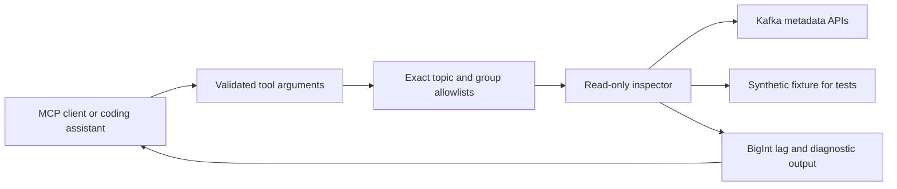

# Kafka Ops MCP

A read-only MCP server that gives an AI client concrete Kafka topic metadata and consumer lag. It uses exact integer arithmetic for offsets, explicit topic/group allowlists, and conservative recovery guidance. The server exposes no producer, consumer-message read, offset-reset, or administrative mutation tool.

**Portfolio focus:** AI-assisted engineering tooling, Kafka diagnostics, access policy, protocol integration, and useful operational semantics.

## Run a real MCP client demonstration

Requires Node.js 20+.

```sh
npm ci
npm test
npm run demo
```

The demo spawns the server, negotiates the MCP stdio protocol, discovers four tools, and calls them against a synthetic fixture. No AI subscription, API key, or live Kafka cluster is needed. The default fixture produces lag `250 + 250 = 500`, including offsets above JavaScript's safe integer range. An unlisted private topic is hidden and direct access is denied.

## Tools

| Tool | Input | Output |
|---|---|---|
| `list_topics` | none | Allowlisted accessible topic names |
| `describe_topic` | topic | Partition leader, replica and ISR metadata |
| `consumer_lag` | group, topic | Per-partition committed/start/end offsets and status |
| `recovery_plan` | group, topic | Observations, warnings and diagnostic steps; no actions |

All tools declare `readOnlyHint` and the server enforces access before querying a selected topic/group. Annotations help clients but are not a security boundary. Policy enforcement and a least-privilege Kafka principal are the boundary. The [official MCP SDK](https://github.com/modelcontextprotocol/typescript-sdk/tree/v1.x) handles schema validation and stdio framing.



Offsets are JSON strings and calculations use `BigInt`. Missing commits, commits below retention, and commits ahead of the log end produce explicit statuses and a null total; they are never silently clamped into a healthy zero. Lag means offset distance, which may differ from actual record count on compacted or transactional topics. Bounds and commits are separate reads, so outputs identify the observation time and do not claim a consistent broker snapshot.

Committed offsets can also reference partitions absent from the bounds read. Those entries appear in `unobservedCommittedPartitions`, sorted by partition ID, with exact string offsets (or null for the `-1` uncommitted sentinel). They make `complete` false and `totalLag` null; `knownPartitionLag` remains only the subtotal for comparable partitions. The recovery tool recommends re-reading metadata, bounds and commits and checking topic identity. A mismatch alone is not treated as evidence of retention loss or a reason to reset offsets. A matching partition set still does not establish an atomic snapshot.

## Use with an MCP host

First run `npm run build`. Configure your host's stdio server entry with absolute paths:

```json
{
  "mcpServers": {
    "kafka-ops": {
      "command": "node",
      "args": ["/absolute/path/kafka-ops-mcp/dist/server.js"],
      "env": {
        "KAFKA_MODE": "fixture",
        "KAFKA_FIXTURE": "/absolute/path/kafka-ops-mcp/fixtures/cluster.json"
      }
    }
  }
}
```

This is a portable stdio configuration example; use your host's current configuration format. Example requests: “Show the partitions for customers”, “Compare committed offsets with the retained log for cdc-recovery-lab”, and “Suggest safe checks before recovering this consumer.” Recovery steps are derived rules, not an LLM-generated diagnosis.

## Connect to a live broker

```sh
KAFKA_MODE=live KAFKA_BROKERS=localhost:9092 \
ALLOWED_TOPICS=customers ALLOWED_GROUPS=cdc-recovery-lab \
node dist/server.js
```

Live mode refuses to start without both allowlists. Comma-separated allowlists use exact names; wildcards are rejected. `KAFKA_TLS=true` enables TLS using the runtime trust store. SASL supports `plain`, `scram-sha-256` and `scram-sha-512`, requires TLS, and accepts `KAFKA_USERNAME`/`KAFKA_PASSWORD` from the process environment. Do not put credentials in tracked configuration. Arbitrary broker errors are replaced with a generic diagnostic failure so broker/credential details are not returned to the AI client.

Grant only broker permissions needed to describe the permitted topics/groups and fetch offsets; deny create/delete/alter/write operations at Kafka as defense in depth. The live adapter does not read message bodies or Schema Registry content.

## Validation and scope

Twelve tests cover exact large offsets, missing commits, retention/truncation, invalid/duplicate metadata, unmatched partition observations, policy enforcement before broker calls, and the actual MCP stdio lifecycle with discovery, allow/deny calls and malformed arguments. The mismatch is also exercised through both `consumer_lag` and `recovery_plan` using a real SDK client and separate server process. The fixture/client demo is validated locally; the live Kafka adapter compiles but requires integration validation against your broker/auth configuration.

There is no hosted HTTP transport, multi-user authentication, Vault rotation loop, historical lag storage, automatic repair, or arbitrary cluster command tool. This narrow scope keeps the AI client useful without giving it operational write capabilities. See [the ADR](docs/adr.md) and [the partition-observation walkthrough](docs/development-2026-10-18.md).
